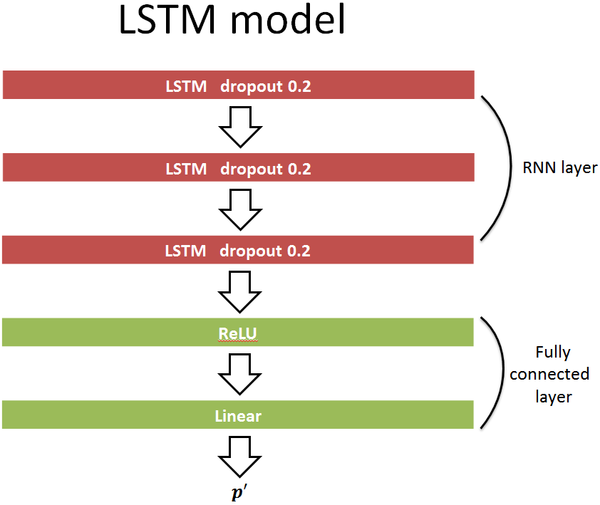

# Dynamic Emotion Recognition with LSTM-RNN

Course final project for **Natural Language Processing**, Department of Electrical
Engineering, National Tsing Hua University (2017).

Authors: Huang-Cheng Chou, Yuan-Tung Ho

## Overview

Most emotion recognition systems assign a single label to a whole utterance. This
project instead tracks emotion **as it changes over time**, predicting continuous
arousal and valence at short time scales so that the emotional contour of a
dyadic interaction can be followed frame by frame.

We then use those continuous predictions for an application: amplifying the
emotional contour of a video, so that footage which feels flat can be re-presented
with visual emphasis that follows what the speakers are actually conveying.

## Dataset: NNIME

The **NNIME** corpus (The NTHU-NTUA Chinese Interactive Multimodal Emotion Corpus)
is a collaboration between engineers and drama experts. It contains roughly
11 hours of synchronously recorded audio, video, and electrocardiogram data from
44 subjects engaged in spontaneous dyadic spoken interactions.

Its annotation is unusually rich: discrete and continuous-in-time labels from
50 annotators per subject, collected from four perspectives — peer-report,
director-report, self-report, and observer-report. It is one of the few
large-scale Chinese affective dyadic interaction databases that have been
systematically collected and released to the research community.

## Models

**SVR baseline.** Support vector regression over acoustic and fastText text
features. Reaches roughly 0.30-0.40 Spearman correlation without tuning, and up
to around 0.70 in favourable segments. We tried feature selection, but using the
full feature set outperformed any subset we tested.

**LSTM-RNN.** Two LSTM models are trained separately for the audio and the text
stream. Per-frame predictions of arousal and valence are aggregated to the
sentence level by averaging.

## Results

Spearman correlation against continuous annotations:

| Model | Activation | Valence |
|---|:---:|:---:|
| SVR (audio) | 0.32 | 0.09 |
| LSTM-RNN (audio) | **0.43** | 0.13 |
| SVR (text) | 0.43 | **0.32** |
| LSTM-RNN (text) | 0.10 | 0.04 |

The audio stream benefits clearly from temporal modelling, while the text stream
does not: with only sentence-level lexical cues available per frame, the LSTM
overfits where the simpler SVR generalises.

## Running the code

1. Download the `code` directory.
2. Update the dataset paths inside the scripts.
3. LSTM-RNN: run `code/LSTM_RNN_Code/LSTM_RNN_Regression.py`
4. SVR: run `code/SVR_code/performSVR.py` (requires the data listed in the
   accompanying link file)

## Repository layout

| Path | Contents |
|---|---|
| `code/` | LSTM-RNN and SVR training and evaluation scripts |
| `demo/` | Emotion-amplified video demonstration |
| `report/` | Written project report |
| `PPT/` | Final presentation slides |

## Note

This is a 2017 undergraduate-era course project, kept here as a record of early
work on continuous emotion recognition. For current research on speech emotion
recognition under subjectivity, see
[EMO-SUPERB](https://github.com/ag027592/EMO-SUPERB) and
[Embracing-Multi-Label](https://github.com/ag027592/Embracing-Multi-Label).

## License

Released under the MIT License. See [LICENSE](LICENSE).
